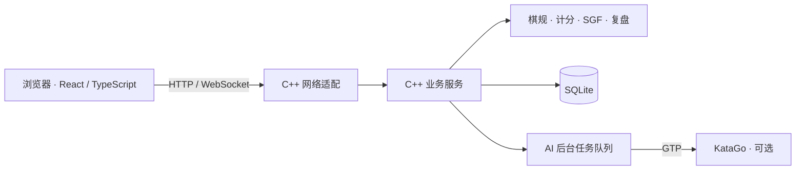

# 弈境围棋 · 在线对弈与棋谱复盘

弈境围棋是一款使用 **C++20 后端与 React / TypeScript 前端**的在线围棋网站，支持实时对弈、房间匹配、观战聊天、SGF 棋谱复盘，以及可选的 KataGo 人机对弈。

打开浏览器即可进入大厅，与朋友开始一局棋，或回看棋谱中的每一步。网站提供 9、13、19 路棋盘，适配桌面与手机屏幕；棋盘采用 SVG 绘制，支持鼠标、触摸和键盘操作。

**当前版本：0.2.0 · 网站架构。** 账号、棋规、对局、计时、聊天、棋谱计算与引擎调度全部由 C++ 实现。前端负责界面与交互，显示服务器返回的棋盘和复盘帧。C++ 服务同时提供 HTTP API、WebSocket 与网页静态资源，生产运行只需 C++ 服务端；Node.js 用于前端开发和构建。

## 可以做什么

| 功能 | 当前能力 |
| --- | --- |
| 在线对弈 | 9 / 13 / 19 路棋盘，实时落子与提子、停一手、认输、双停结束和结果记录 |
| 房间与匹配 | 创建房间、六位房间码邀请、公开房间观战、按棋盘大小匹配对手 |
| 账号与实时连接 | 注册与登录、会话鉴权、断线重连、刷新后的房间与座位恢复 |
| 对局计时与聊天 | 主时间与单步读秒、超时判定、房间聊天与历史消息 |
| 棋谱与复盘 | 对局记录、SGF 导入导出、逐手回看、停一手和提子后的局面还原 |
| 可选人机对弈 | 通过 GTP 接入 KataGo，独立后台队列调度；未配置真实引擎时明确显示不可用 |

棋规支持提子、自杀禁着、简单劫与中国数子，白贴 7.5。当前规则和 SGF 的具体范围见下方[功能边界](#功能边界)。

## 技术与模块架构

| 层次 | 技术与职责 |
| --- | --- |
| 网页界面 | React、TypeScript、SVG、按功能拆分的 CSS；Vite 构建静态资源 |
| 网络适配 | C++20、Crow / Asio，提供 HTTP、WebSocket、鉴权与协议适配 |
| 业务服务 | C++20 模块分别处理账号、房间、匹配、对局、计时、聊天、记录、复盘和 AI |
| 棋规与棋谱 | 独立 C++ 领域模块，计算合法着法、提子、计分和 SGF 复盘帧 |
| 数据与引擎 | SQLite 持久化，Windows BCrypt 处理密码与令牌哈希，KataGo GTP 进程适配 |
| 工程与验证 | CMake / MSVC、CTest、前端 lint / 格式检查 / 构建、Playwright 浏览器回归 |



入口文件只创建依赖和组装模块。业务实现按职责拆分，棋规不依赖网络或 UI，浏览器不维护第二套规则引擎。Qt 桌面客户端已移除，项目不依赖 Qt 或 Electron。

## 快速启动

当前已支持并验证的服务端平台为 **Windows x64 / MSVC / C++20**。客户端使用现代电脑或手机浏览器。

构建环境需要 Git、Node.js 22.12+、CMake 3.24+，以及安装了 C++ 桌面开发工具的 Visual Studio 2026；默认 CMake 预设使用 Visual Studio 2026。当前验证环境使用 Node.js 24。建议将仓库放在全英文路径，例如 `E:\weiqi`。

```powershell
git clone https://github.com/tengyun7861/weiqi.git
Set-Location .\weiqi
.\scripts\build.ps1 -Configuration Release
.\scripts\start.ps1
```

浏览器打开 **http://127.0.0.1:8081**。已有本地仓库时，从构建命令开始执行。

构建脚本依次执行前端依赖安装、lint、格式检查、生产构建、C++ 编译、CTest 与安装打包。首次构建会下载固定版本并校验哈希的 C++ 依赖；前端通过 `npm ci` 使用锁定依赖。

启动脚本默认使用 Release 后端、`client-web/dist` 网页与 `data/weiqi.sqlite3` 数据库。构建后的运行包位于 `build-msvc/site-package/bin/`，包含 `weiqi_server.exe` 和 `web/` 静态资源目录。数据库属于运行数据，需要单独保存。

两个棋手分别注册账号，一方创建房间，另一方输入六位房间码。同一台电脑可使用不同浏览器或独立浏览器上下文。对局结束后进入棋谱库，可逐手回看与下载 SGF。

## 目录与模块

```text
weiqi/
├── server-cpp/
│   ├── include/weiqi/          领域接口、数据类型与适配器接口
│   │   ├── api/               HTTP、实时网关与序列化接口
│   │   └── detail/            数据库绑定与计分辅助
│   ├── src/
│   │   ├── main.cpp           启动配置与依赖创建
│   │   ├── api_server.cpp     组装路由、实时网关与计时循环
│   │   ├── api/               按账号、房间、棋谱、复盘、AI 拆分的路由
│   │   ├── services/          房间、对局、计时、匹配、聊天、记录等实现
│   │   ├── go_board.cpp       无网络和 UI 依赖的棋规
│   │   ├── sgf.cpp            SGF 读写
│   │   ├── replay.cpp         C++ 逐手棋盘计算
│   │   ├── auth.cpp           密码与会话鉴权
│   │   ├── database.cpp       SQLite 生命周期与迁移
│   │   ├── katago_gtp.cpp     引擎进程与 GTP 协议
│   │   ├── ai_worker.cpp      独立线程中的完整 AI 任务队列
│   │   └── web_assets.cpp     安全的网页资源路径解析
│   └── tests/                 C++ 单元与网络集成检查
├── client-web/
│   └── src/
│       ├── App.tsx            页面与对话框组装
│       ├── pages/             大厅、对弈、人机、棋谱页面
│       ├── components/        棋盘、棋手面板、聊天、登录与建房组件
│       ├── hooks/             独立的会话、连接、房间、对局、聊天、AI、复盘状态
│       ├── lib/               HTTP、WebSocket、类型与显示格式
│       └── styles/            按页面和组件拆分的样式
├── scripts/                   构建、启动与真实浏览器回归
├── docs/                      架构、部署、界面设计与协议说明
├── CMakePresets.json           Windows Debug / Release 预设
└── AGENTS.md                  后续开发的模块边界约定
```

`GameService` 统一维护共享棋局状态与互斥锁，其业务实现按职责放在独立的 `services/*_service.cpp` 中。`main.cpp`、`api_server.cpp`、`App.tsx` 和 `useWeiqi.ts` 保持为组装层。新增功能先确定所属模块，再扩展对应接口和实现，详见[架构与扩展约定](docs/architecture.md)。

## 开发与验证

完整 Debug 构建：

```powershell
.\scripts\build.ps1 -Configuration Debug
```

前端开发模式由 Vite 代理到 C++ 服务，生产环境直接由 C++ 提供构建后的网页：

```powershell
# 第一个终端
.\scripts\start.ps1 -Configuration Debug
# 第二个终端
npm.cmd --prefix client-web run dev
```

浏览器回归使用 Python / Playwright 作为开发测试工具，不参与网站运行。安装并执行：

```powershell
python -m pip install playwright
python -m playwright install chromium
# 使用独立测试数据库启动 C++ 服务；勿用正式业务数据库跑回归
.\scripts\start.ps1 -DatabasePath .\verification\browser.sqlite3 -Port 8130
# 另一个终端
python .\scripts\web_e2e.py --url http://127.0.0.1:8130 --output verification
```

浏览器回归覆盖三账号、双人落子与提子、聊天、刷新恢复、观战、页面切换、匹配、双停结束、认输、C++ 复盘、SGF 导入导出、手机宽度和会话撤销；截图与报告写入被忽略的 `verification/`。

C++ 测试分别覆盖棋规、核心服务、GTP 协议、HTTP API、WebSocket、静态资源路径、复盘与 AI 任务调度。网页流程或协议改动后，需要在独立测试数据库上运行完整浏览器回归。

数据库、模型、令牌、截图、编译产物与生成包不提交到仓库。C++ 格式遵循根目录 `.clang-format`；前端检查命令和模块扩展规范见 [AGENTS.md](AGENTS.md)。

## 功能边界

- 棋规支持落子、提子、自杀禁着、简单劫和中国数子，白贴 7.5；双停后按当前盘面自动计分。死活争议协商与超级劫尚未实现。
- SGF 导入支持 9、13、19 路、正常轮流落子的单局主线，包含停一手与提子；暂不支持变化分支、摆子和让子，遇到这些内容会明确报错。
- KataGo 需要实际引擎、模型与配置。未配置时网页明确显示不可用；GTP 测试替身仅用于验证协议、调度与错误路径，不能代替真实模型验收。
- 当前后端的密码实现与引擎进程适配使用 Windows API。Linux 服务端移植需要补上对应适配器。
- 本项目支持本地运行；公网域名、HTTPS 与真实服务器部署尚未验收，配置方式见[部署说明](docs/deployment.md)。

## 项目文档

| 文档 | 内容 |
| --- | --- |
| [架构与扩展约定](docs/architecture.md) | 模块所有权、依赖边界与新增功能的位置 |
| [后端说明](server-cpp/README.md) | C++ 构建、服务端参数、鉴权与 KataGo 配置 |
| [前端说明](client-web/README.md) | 页面、组件、状态模块和网页开发 |
| [实时协议](docs/protocol.md) | HTTP / WebSocket 消息与交互约定 |
| [部署说明](docs/deployment.md) | 运行包、数据目录、反向代理与 HTTPS |
| [界面设计](docs/web-design.md) | 网页布局、视觉与交互约定 |

项目使用 [MIT License](LICENSE)。
