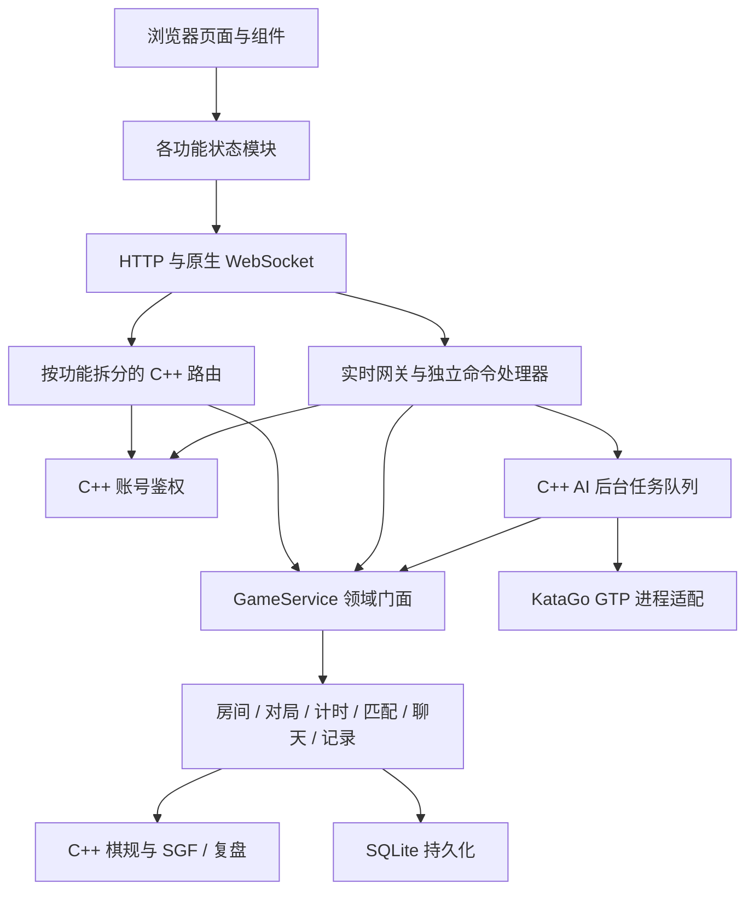

# 模块职责与扩展约定

本项目使用分层结构。文件依据实际职责划分，入口只组装模块。目录拆分用于约束依赖方向，不需要把每个功能变成独立进程。

## 模块所有权

| 功能 | 后端业务文件 | 后端网络适配 | 前端状态与界面 |
| --- | --- | --- | --- |
| 账号 | `auth.cpp` | `auth_routes.cpp` | `useSession`、`AuthDialog` |
| 房间 | `rooms_service.cpp` | `room_routes.cpp`、`realtime_rooms.cpp` | `useLobby`、`Lobby`、`CreateRoomDialog` |
| 匹配 | `matchmaking_service.cpp` | `realtime_matchmaking.cpp` | `useMatchmaking` 与大厅匹配区 |
| 在线对局 | `gameplay_service.cpp`、`game_state_service.cpp` | `realtime_gameplay.cpp` | `useGame`、`Game`、`Board`、`PlayersPanel` |
| 计时 | `clock_service.cpp` | 快照事件序列化 | `PlayersPanel` 展示服务器时钟 |
| 聊天 | `chat_service.cpp` | `realtime_chat.cpp` | `useChat`、`ChatPanel` |
| 棋谱记录 | `records_service.cpp` | `record_routes.cpp` | `useRecords`、`Replay` 列表 |
| SGF 复盘 | `sgf.cpp`、`replay.cpp` | `replay_routes.cpp`、`record_routes.cpp` | `useReplay`、`Replay`；只选帧与展示 |
| 人机 | `ai_service.cpp`、`ai_worker.cpp`、`katago_gtp.cpp` | `ai_routes.cpp`、实时 AI 重试命令 | `useAi`、`Ai` |
| 数据库 | `database.cpp`、`persistence_service.cpp` | 不由 API 直接处理对局 SQL | 不可直接访问 |
| 静态网页 | `web_assets.cpp` | `asset_routes.cpp` | Vite 只用于开发与构建 |

`GameService` 是对共享棋局状态的门面，不是所有功能算法所在的单文件。它保持唯一棋局副本和锁，其成员方法实现分别在上述业务文件。状态与持久化目前使用单进程架构；多实例扩展需要先设计跨进程房间归属与存储。

## 依赖与维护规则

1. 棋规、SGF、复盘不依赖 HTTP、Crow、React 或浏览器。
2. 网络层负责解析请求、鉴权、协议回复与事件传输；业务判断交给领域模块。
3. 后端新增功能用 C++，先明确业务归属，再添加对应路由或命令文件。不要在 `main.cpp` 或 `api_server.cpp` 里实现业务。
4. 页面和 `useWeiqi` 负责组合。新增状态进入对应功能 Hook；新增独立界面进入组件或页面文件，样式进入对应样式文件。
5. 棋局只有服务端一个可信来源。网页不可自行判定合法落子、提子、得分或复盘结果。
6. 业务事件与请求确认分开，棋局版本只用于同一房间的快照顺序。不要用它过滤聊天、错误或鉴权。
7. 更改领域行为运行对应 C++ 测试；更改跨端协议或页面流程运行真实 C++ 服务上的浏览器回归。

当前部署形态是一个 C++ 服务进程和可选 KataGo 子进程。没有 Node.js 后端、Qt 页面、Electron 外壳或服务端渲染层。源码层次保留规则、领域和网络三个独立依赖层，后续可替换存储或引擎适配器。
